<div align="center">


# AT URI Syntax Compatibility and Round-Trip Validator

**Problem Statement: PS-026**  
**Project Code: A3-PS026-TC073 · AIORI Hackathon 3 · 6G & Future Networks**

<p align="center">
  
  
  
</p>

<p>
  
  
  
  
</p>

<a href="https://youtu.be/q6_cSCNCk_s?si=WVBeHfXlIBHVIyU7">
  
</a>
&nbsp;
<a href="https://youtu.be/rQl8qc3ovc8?si=hfWA_Vnl4Suaje3C">
  
</a>
&nbsp;
<a href="https://github.com/aiori-hackathon/A3-PS026-TC073">
  
</a>

<br/>

**Understand how AT Protocol identifiers are interpreted, validated and reconstructed by different parsing strategies.**

<sub>VISUAL SYSTEM · MIDNIGHT NAVY / ELECTRIC BLUE / CYAN · TECHNICAL DIAGRAMS / STRUCTURED DATA / REPRODUCIBLE ANALYSIS</sub>

<p>
  
  
  
  
</p>

<sub>DESIGN LANGUAGE · DARK GRAPHITE · MIDNIGHT NAVY · ELECTRIC CYAN · MONOSPACED TECHNICAL DIAGRAMS</sub>

</div>

---

<a id="contents"></a>
# CONTENTS

<details open>
<summary><strong>Full navigation — 24 sections and all subtopics</strong></summary>

- **[Project Overview](#project-overview)**
  - [Project at a glance](#project-at-a-glance)
  - [What the application is designed to do](#what-the-application-is-designed-to-do)
  - [PARSE](#parse)
  - [COMPARE](#compare)
  - [RECONSTRUCT](#reconstruct)
- **[Problem Statement](#problem-statement)**
  - [2.1 The compatibility problem](#21-the-compatibility-problem)
  - [2.2 Three issues to investigate](#22-three-issues-to-investigate)
  - [2.3 The central question](#23-the-central-question)
- **[At Uri Fundamentals](#at-uri-fundamentals)**
  - [3.1 Structure](#31-structure)
  - [3.2 Components](#32-components)
  - [3.3 Handle and DID authorities](#33-handle-and-did-authorities)
  - [3.4 Example breakdown](#34-example-breakdown)
- **[Objectives And Scope](#objectives-and-scope)**
  - [4.1 Objectives](#41-objectives)
  - [4.2 Scope of the current repository](#42-scope-of-the-current-repository)
- **[Proposed Solution](#proposed-solution)**
  - [Main solution components](#main-solution-components)
- **[Final System Architecture](#final-system-architecture)**
  - [Layer responsibilities](#layer-responsibilities)
- **[Architecture-To-Code Mapping](#architecture-to-code-mapping)**
  - [Current parsing strategies in code](#current-parsing-strategies-in-code)
- **[Repository Structure](#repository-structure)**
  - [Important source files](#important-source-files)
- **[Processing Workflow](#processing-workflow)**
  - [Processing stages](#processing-stages)
- **[Parsing Strategies](#parsing-strategies)**
  - [10.1 Why multiple strategies?](#101-why-multiple-strategies)
  - [10.2 Strategy comparison](#102-strategy-comparison)
  - [10.3 Example: DID authority](#103-example-did-authority)
  - [10.4 Strategy execution example](#104-strategy-execution-example)
- **[Conflict Analysis](#conflict-analysis)**
  - [Conflict categories in the project design](#conflict-categories-in-the-project-design)
- **[Encoding And Unicode Analysis](#encoding-and-unicode-analysis)**
  - [12.1 Percent-encoding analysis](#121-percent-encoding-analysis)
  - [12.2 Unicode analysis](#122-unicode-analysis)
  - [Why this matters](#why-this-matters)
- **[Round-Trip Validation](#round-trip-validation)**
  - [13.1 Meaning](#131-meaning)
  - [13.2 Example](#132-example)
  - [13.3 Interpretation](#133-interpretation)
- **[Test Corpus](#test-corpus)**
  - [14.1 Purpose](#141-purpose)
  - [14.2 Corpus categories](#142-corpus-categories)
  - [14.3 Example test case](#143-example-test-case)
  - [14.4 Corpus execution](#144-corpus-execution)
  - [14.5 Why a corpus matters](#145-why-a-corpus-matters)
- **[Algorithms](#algorithms)**
  - [Algorithm 1 — Parse an AT URI](#algorithm-1-parse-an-at-uri)
  - [Algorithm 2 — Detect conflicts](#algorithm-2-detect-conflicts)
  - [Algorithm 3 — Run the corpus](#algorithm-3-run-the-corpus)
  - [Algorithm 4 — Round-trip check](#algorithm-4-round-trip-check)
- **[Data Flow Diagrams](#data-flow-diagrams)**
  - [16.1 Level 0 — Context Diagram](#161-level-0-context-diagram)
  - [16.2 Level 1 — Main Processing DFD](#162-level-1-main-processing-dfd)
  - [16.3 Level 2 — Parsing and Conflict Analysis](#163-level-2-parsing-and-conflict-analysis)
- **[Uml Diagrams](#uml-diagrams)**
  - [17.1 Use Case Diagram](#171-use-case-diagram)
  - [17.2 Class Diagram](#172-class-diagram)
  - [17.3 Sequence Diagram](#173-sequence-diagram)
  - [17.4 Activity Diagram](#174-activity-diagram)
- **[Dashboard And Pages](#dashboard-and-pages)**
  - [Dashboard workflow](#dashboard-workflow)
- **[Installation And Execution](#installation-and-execution)**
  - [19.1 Prerequisites](#191-prerequisites)
  - [19.2 Clone the repository](#192-clone-the-repository)
  - [19.3 Create a virtual environment](#193-create-a-virtual-environment)
  - [Windows PowerShell](#windows-powershell)
  - [Linux / macOS](#linux-macos)
  - [19.4 Install dependencies](#194-install-dependencies)
  - [19.5 Start the application](#195-start-the-application)
  - [19.6 Run automated tests](#196-run-automated-tests)
  - [19.7 Generate and download reports](#197-generate-and-download-reports)
  - [Execution flow](#execution-flow)
- **[Api Reference](#api-reference)**
  - [20.1 Validate one URI](#201-validate-one-uri)
  - [20.2 Compare strategies](#202-compare-strategies)
  - [20.3 Check round-trip](#203-check-round-trip)
  - [20.4 Analyse encoding](#204-analyse-encoding)
  - [20.5 Batch validation](#205-batch-validation)
  - [20.6 Health check](#206-health-check)
- **[Sample Requests](#sample-requests)**
  - [Example 1 — Valid handle-based URI](#example-1-valid-handle-based-uri)
  - [Example 2 — DID-based URI](#example-2-did-based-uri)
  - [Example 3 — Invalid scheme case](#example-3-invalid-scheme-case)
  - [Example 4 — Invalid record-key character](#example-4-invalid-record-key-character)
- **[Testing And Results](#testing-and-results)**
  - [22.1 Testing strategy](#221-testing-strategy)
  - [22.2 Run the tests](#222-run-the-tests)
  - [22.3 Report formats](#223-report-formats)
  - [22.4 Interpreting corpus status](#224-interpreting-corpus-status)
- **[Limitations And Future Scope](#limitations-and-future-scope)**
  - [23.1 Current limitations](#231-current-limitations)
  - [23.2 Future improvements](#232-future-improvements)
  - [23.3 Future architecture direction](#233-future-architecture-direction)
- **[Team And References](#team-and-references)**
  - [Project team](#project-team)
  - [Hackathon information](#hackathon-information)
  - [Technical references](#technical-references)

</details>

---

<a id="project-overview"></a>
<a id="section-01"></a>
# 01. Project Overview
<p align="left">
  
</p>

The **AT URI Syntax Compatibility & Round-Trip Validator** is a Python-based testing and analysis application for studying how AT Protocol identifiers are parsed and validated.

An AT URI can contain a Decentralized Identifier (DID) in its authority. A DID contains colon characters, for example `did:plc:abc123`. Generic URI authority grammar commonly interprets a colon as a possible host/port separator. This creates an interoperability question: do different parsing approaches preserve and interpret the AT URI components consistently?

The project accepts individual URIs and a predefined test corpus. It evaluates the input using multiple parsing strategies, compares extracted components, identifies disagreements, checks percent-encoding and Unicode behaviour, reconstructs the URI, and presents results through a Flask web interface and downloadable reports.

## Project at a glance

| Attribute | Details |
|---|---|
| Project | AT URI Syntax Compatibility & Round-Trip Validator |
| Project ID | A3-PS026-TC073 |
| Event | AIORI Hackathon 3 |
| Track | 6G & Future Networks |
| Language | Python |
| Web framework | Flask |
| Core engine | Custom AT URI parsing and analysis modules |
| Test corpus | 105 built-in cases in the repository version inspected |
| Parsing strategies | `standard`, `strict`, `compatibility`, `rfc3986` |
| Reports | JSON, CSV and HTML |
| Interface | Browser-based dashboard and analysis pages |

## What the application is designed to do

<table>
<tr>
<td width="33%" align="center">

### PARSE

Read the AT URI structure and validate its authority, collection and record key.

</td>
<td width="33%" align="center">

### COMPARE

Run multiple strategies and identify differences in validation and component extraction.

</td>
<td width="33%" align="center">

### RECONSTRUCT

Rebuild the URI and compare it with the original input to detect information loss.

</td>
</tr>
</table>

---

<a id="problem-statement"></a>
<a id="section-02"></a>
# 02. Problem Statement
<p align="left">
  
</p>

## 2.1 The compatibility problem

A typical AT URI has this structure:

```text
at://AUTHORITY/COLLECTION/RECORD_KEY
```

Example:

```text
at://did:plc:abc123/app.bsky.feed.post/3kxyz
```

Its components are:

```text
Scheme       : at
Authority    : did:plc:abc123
Collection   : app.bsky.feed.post
Record Key   : 3kxyz
```

The authority is a handle or DID. The DID form contains colons. Generic URI parsing rules define an authority structure that can include a host followed by a colon-delimited port. Depending on the implementation, a generic parser may preserve the authority as text, split its subcomponents, reject it, or interpret it differently.

## 2.2 Three issues to investigate

| Issue | Explanation | Possible consequence |
|---|---|---|
| Parser behaviour | Different implementations may interpret the same authority differently. | Inconsistent component extraction. |
| Syntax validation | A generic parser accepting a string does not prove that it is a valid AT URI. | Incorrect acceptance or rejection. |
| Resolution failure | A syntactically valid identifier may still refer to an unavailable account or record. | A valid URI may not resolve over the network. |

> **Important distinction:** Syntax validation and network resolution are different operations. This project focuses on syntax, parser behaviour, compatibility and reconstruction; it does not establish that a remote record exists.

## 2.3 The central question

**Can different parsing strategies process an AT URI consistently while preserving the original identifier exactly?**

---

<a id="at-uri-fundamentals"></a>
<a id="section-03"></a>
# 03. At Uri Fundamentals
<p align="left">
  
</p>

## 3.1 Structure

```text
┌──────────────────────────────────────────────────────────────────────┐
│                                                                      │
│  at://AUTHORITY/COLLECTION/RECORD_KEY                                │
│  ─────  ─────────  ──────────────  ──────────                       │
│    │        │             │             │                            │
│    │        │             │             └── Identifies one record    │
│    │        │             └──────────────── Record collection NSID   │
│    │        └────────────────────────────── Handle or DID             │
│    └─────────────────────────────────────── AT URI scheme             │
│                                                                      │
└──────────────────────────────────────────────────────────────────────┘
```

## 3.2 Components

| Component | Example | Meaning |
|---|---|---|
| Scheme | `at` | Identifies the AT URI scheme. |
| Authority | `alice.bsky.social` | Handle identifying an account. |
| Authority | `did:plc:abc123` | Decentralized identifier. |
| Collection | `app.bsky.feed.post` | Identifies the record collection. |
| Record key | `3kxyz` | Identifies a record within the collection. |

## 3.3 Handle and DID authorities

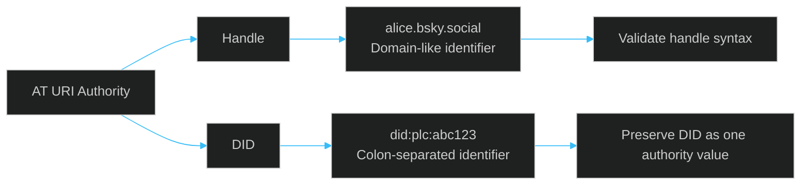

A handle is domain-like. A DID has a method and method-specific identifier separated by colons. The DID must not be casually split into host and port fields simply because it contains colons.

## 3.4 Example breakdown

```text
Input:
at://did:plc:abc123/app.bsky.feed.post/3kxyz

Scheme       = at
Authority    = did:plc:abc123
Collection   = app.bsky.feed.post
Record key   = 3kxyz
```

---

<a id="objectives-and-scope"></a>
<a id="section-04"></a>
# 04. Objectives And Scope
<p align="left">
  
</p>

## 4.1 Objectives

1. Validate AT URI input against the project's AT-specific rules.
2. Evaluate the same URI using different parsing strategies.
3. Preserve the authority, collection and record-key components.
4. Detect disagreements in validation and extracted components.
5. Analyse percent-encoding and Unicode representations.
6. Reconstruct the URI from parsed components.
7. Compare original and reconstructed values.
8. Run repeatable tests over a corpus of valid, invalid and edge-case inputs.
9. Present case-level and aggregate results through the web application.
10. Export reports in JSON, CSV and HTML formats.

## 4.2 Scope of the current repository

| Included in the current code | Not established as implemented |
|---|---|
| Four parsing strategies in the custom parser module | Two independent third-party parser libraries |
| Component extraction and validation | Full standards-conformance certification |
| Cross-strategy conflict detection | Network-based DID/handle resolution |
| Percent-encoding inspection | A complete reversible tokenization pipeline |
| NFC/NFD Unicode analysis | A historical parser-version database |
| URI reconstruction and exact string comparison | A production security middleware |
| Built-in corpus and test runner | Continuous compatibility monitoring |
| Flask pages and JSON endpoints | Optional Spec Oracle, Time Vault and Shield services |

This distinction keeps the documentation faithful to the code currently present in the repository. The final architecture diagram describes the complete design direction; the mapping section later in this README identifies which parts are implemented and which remain future or design-level components.

---

<a id="proposed-solution"></a>
<a id="section-05"></a>
# 05. Proposed Solution
<p align="left">
  
</p>

The solution is a **corpus-driven parser analysis application**.

Each test case contains an identifier, expected label, category and purpose. The engine evaluates the original URI under four strategies. It records the results, compares the validation state and extracted components, checks for reconstruction differences, and returns structured data to the dashboard or report generator.

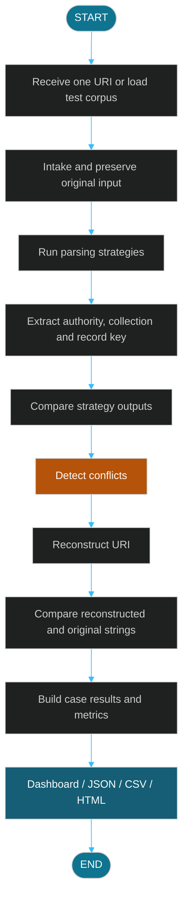

## Main solution components

| Component | Responsibility |
|---|---|
| Intake | Receives an individual URI or corpus input. |
| AT URI parser | Extracts and validates the AT URI components. |
| Strategy selector | Applies one of the four parsing strategies. |
| Conflict analyzer | Compares validity and extracted component values. |
| Encoding analyzer | Inspects percent escapes and encoded delimiters. |
| Unicode analyzer | Compares original, NFC and NFD representations. |
| Reconstruction | Rebuilds an AT URI from parsed components. |
| Corpus runner | Executes all corpus cases and calculates pass/fail/review totals. |
| Reporting | Produces JSON, CSV and HTML output. |
| Flask application | Serves the dashboard pages and API endpoints. |

---

<a id="final-system-architecture"></a>
<a id="section-06"></a>
# 06. Final System Architecture
<p align="left">
  
</p>

The following architecture follows the supplied final architecture diagram. It shows the intended end-to-end design, including the input gate, AT URI lenses, generic parser comparison, compatibility alignment, conflict classification, transformation engine, round-trip validation and automated test runner.

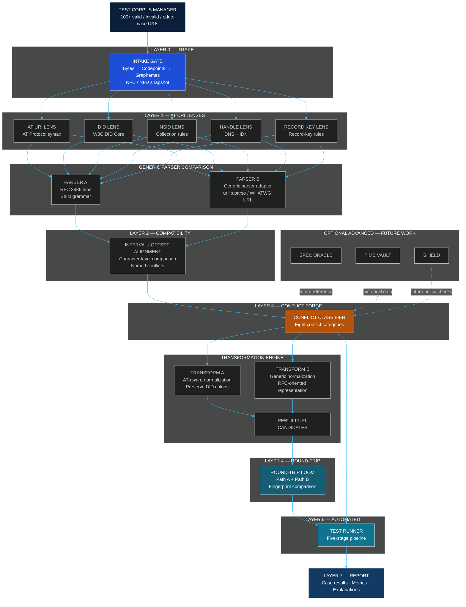

## Layer responsibilities

| Layer / block | Responsibility |
|---|---|
| Test Corpus Manager | Supplies valid, invalid and edge-case identifiers. |
| Layer 0 — Intake | Preserves the input and records character/Unicode information. |
| Layer 1 — AT URI Lenses | Examines the URI, DID, NSID, handle and record-key components. |
| Generic Parser Comparison | Compares an RFC-oriented interpretation with a generic parser adapter. |
| Layer 2 — Compatibility | Aligns extracted components and identifies character-level differences. |
| Layer 3 — Conflict Forge | Assigns meaningful conflict categories. |
| Transformation Engine | Tests alternate representations and normalization approaches. |
| Layer 4 — Round-Trip | Reconstructs the URI and checks exact preservation. |
| Layer 6 — Automated | Runs the test pipeline over the corpus. |
| Layer 7 — Report | Presents case-level findings and aggregate metrics. |
| Optional Advanced | Spec Oracle, Time Vault and Shield are future-work extensions. |

> **Implementation note:** This is the final target architecture supplied for the project. The current code has a custom parser with four strategies and a cross-strategy analyzer. It does not yet implement every separate lens, interval-tree alignment block, independent WHATWG adapter, Spec Oracle, Time Vault or Shield as standalone modules. See [Architecture-to-Code Mapping](#-7-architecture-to-code-mapping).

---

<a id="architecture-to-code-mapping"></a>
<a id="section-07"></a>
# 07. Architecture-To-Code Mapping
<p align="left">
  
</p>

This section connects the final architecture to the repository's actual Python modules and Flask routes.

| Architecture block | Current repository implementation | Status |
|---|---|---|
| Test corpus input | `engine/corpus.py` | Implemented |
| Intake / URI split | `engine/parser.py` — `_split()` | Implemented in a compact form |
| AT URI / DID / handle / NSID / record-key checks | `engine/parser.py` — regular expressions and validation functions | Implemented in one parser module |
| Parser strategies | `engine/parser.py` — `STRATEGIES` | Implemented |
| Compatibility / conflict analysis | `engine/analyzer.py` — `detect_conflicts()` | Implemented |
| Percent-encoding analysis | `engine/analyzer.py` — `analyze_percent_encoding()` | Implemented |
| Unicode snapshot | `engine/analyzer.py` — `analyze_unicode()` | Implemented |
| Reconstruction | `engine/parser.py` — `reconstruct()` | Implemented |
| Automated corpus runner | `engine/runner.py` — `run_corpus()` | Implemented |
| Web/API layer | `app.py` | Implemented |
| JSON / CSV / HTML report builders | `reports.py` | Implemented |
| Browser pages | `templates/` and `static/` | Present in repository |
| Independent RFC 3986 and WHATWG parser adapters | Separate external parser adapters | Further implementation required |
| Interval-tree offset alignment | Dedicated alignment module | Future enhancement |
| Separate Transform A / Transform B reversible pipeline | Dedicated transformation module | Further implementation required |
| Spec Oracle / Time Vault / Shield | Optional advanced modules | Future work |

## Current parsing strategies in code

The repository currently defines these four strategy names:

```python
STRATEGIES = [
    "standard",
    "strict",
    "compatibility",
    "rfc3986"
]
```

They are implemented in `engine/parser.py`. They are four modes of the project's custom parser, not four independent external parser libraries.

---

<a id="repository-structure"></a>
<a id="section-08"></a>
# 08. Repository Structure
<p align="left">
  
</p>

The public repository currently contains the following top-level directories and files:

```text
A3-PS026-TC073/
│
├── engine/
│   ├── parser.py          # AT URI parsing strategies and reconstruction
│   ├── analyzer.py        # Conflict, percent-encoding and Unicode analysis
│   ├── corpus.py          # Built-in test corpus
│   ├── runner.py          # Single-case and corpus execution
│   └── ml_model.py        # Experimental ML conflict prediction
│
├── src/                   # Supporting source assets
│
├── static/                # CSS, JavaScript and visual assets
│
├── templates/             # Flask HTML pages
│
├── tests/
│   └── test_engine.py     # Parser, analyzer and corpus tests
│
├── app.py                 # Flask application and API routes
├── reports.py             # JSON, CSV and HTML report generation
├── requirements.txt       # Python dependencies
├── README.md              # Project documentation
├── VIDEO_LINK.md          # Demo-video reference
│
├── AT URI Syntax Compatibility and Round-Trip Validator.pdf
└── Proposed-structure-hackathon.pdf
```

### Important source files

| File | What it does |
|---|---|
| `engine/parser.py` | Defines URI component extraction, validation strategies and reconstruction. |
| `engine/analyzer.py` | Detects cross-strategy disagreements and analyses encoding/Unicode. |
| `engine/corpus.py` | Stores the built-in test cases and exposes corpus loading. |
| `engine/runner.py` | Runs one URI or the full corpus and classifies case outcomes. |
| `engine/ml_model.py` | Experimental Random Forest prediction endpoint. |
| `app.py` | Connects the engine to Flask pages and JSON APIs. |
| `reports.py` | Builds JSON, CSV and HTML reports from actual corpus results. |
| `tests/test_engine.py` | Contains automated tests for core engine behaviour. |

---

<a id="processing-workflow"></a>
<a id="section-09"></a>
# 09. Processing Workflow
<p align="left">
  
</p>

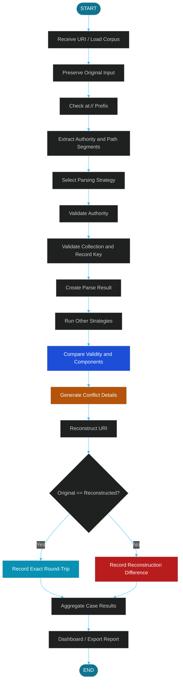

## Processing stages

| Stage | Operation | Output |
|---|---|---|
| 1 | Input intake | Original URI string |
| 2 | URI split | Authority and path segments |
| 3 | Strategy execution | Validation result and extracted fields |
| 4 | Component comparison | Detected differences |
| 5 | Conflict analysis | Conflict list and explanations |
| 6 | Reconstruction | Rebuilt URI |
| 7 | Round-trip check | Exact match / mismatch |
| 8 | Reporting | Case results and aggregate summary |

---

<a id="parsing-strategies"></a>
<a id="section-10"></a>
# 10. Parsing Strategies
<p align="left">
  
</p>

## 10.1 Why multiple strategies?

The project uses multiple validation modes to show how stricter and more permissive interpretations can produce different outcomes for the same input. The results are compared to identify disagreements.

## 10.2 Strategy comparison

| Strategy | Purpose in the current code |
|---|---|
| `standard` | Validates DID or handle authority using the standard project rules and checks path components. |
| `strict` | Applies stricter authority and path checks, including additional DID/NSID/record-key checks. |
| `compatibility` | Uses a more permissive authority approach and records suspicious colon usage. |
| `rfc3986` | Simulates generic host/port interpretation to expose possible DID-colon ambiguity. |

## 10.3 Example: DID authority

**Input**

```text
at://did:plc:abc123/app.bsky.feed.post/3kxyz
```

**AT-specific component interpretation**

```text
Authority   = did:plc:abc123
Collection  = app.bsky.feed.post
Record key  = 3kxyz
```

The authority should remain one DID identifier. The `rfc3986` strategy in this project deliberately checks how a generic host/port interpretation can create ambiguity.

## 10.4 Strategy execution example

```python
from engine.parser import parse_at_uri, STRATEGIES

uri = "at://did:plc:abc123/app.bsky.feed.post/3kxyz"

for strategy in STRATEGIES:
    result = parse_at_uri(uri, strategy)
    print(strategy, result.valid, result.authority, result.errors, result.warnings)
```

---

<a id="conflict-analysis"></a>
<a id="section-11"></a>
# 11. Conflict Analysis
<p align="left">
  
</p>

The analyzer compares the output from every configured strategy. It currently detects disagreements in:

- Validation status.
- Authority extraction.
- Collection extraction.
- Record-key extraction.
- Reconstruction of a URI marked valid by a strategy.

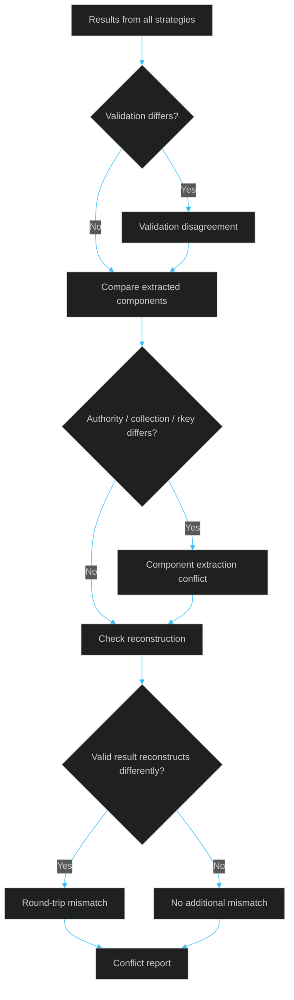

## Conflict categories in the project design

The proposed design groups parser compatibility issues into eight conceptual categories. The current `detect_conflicts()` implementation emits data-driven conflict records for validation disagreement, component extraction conflict and round-trip mismatch; it does not yet emit a fixed C1–C8 taxonomy as eight separate classifier branches.

| Design category | What it investigates |
|---|---|
| C1 — DID colon vs port | Whether DID colons are misread as host/port separators. |
| C2 — Parser rejection | Whether parsing strategies disagree on acceptance. |
| C3 — Authority splitting | Whether the authority is divided or extracted differently. |
| C4 — Case normalization | Whether case handling changes interpretation. |
| C5 — Percent-encoding drift | Whether encoded characters are decoded or normalized differently. |
| C6 — Path / query / fragment | Whether path and optional URI components are treated differently. |
| C7 — Record-key validation | Whether record-key rules are applied consistently. |
| C8 — Resolution failure | Whether syntax validity is confused with remote record availability. |

> C1–C8 are the project's analysis taxonomy. Do not interpret the current generic conflict records as proof that every category already has a dedicated implementation.

---

<a id="encoding-and-unicode-analysis"></a>
<a id="section-12"></a>
# 12. Encoding And Unicode Analysis
<p align="left">
  
</p>

The current analyzer includes two supporting functions.

## 12.1 Percent-encoding analysis

`analyze_percent_encoding(text)`:

1. Scans the input for `%` escape sequences.
2. Checks whether each escape has two hexadecimal characters.
3. Records valid escapes.
4. Records malformed escapes and their positions.
5. Decodes the input for comparison.
6. Identifies encoded delimiters such as `%2F`, `%3A` and `%23`.

Example:

```python
from engine.analyzer import analyze_percent_encoding

result = analyze_percent_encoding("did%3Aplc%3Aabc123")
print(result)
```

## 12.2 Unicode analysis

`analyze_unicode(text)` compares:

- The original string.
- NFC-normalized text.
- NFD-normalized text.
- Unicode code points.
- UTF-8 byte representations.

```python
from engine.analyzer import analyze_unicode

result = analyze_unicode("café")
print(result["nfc_equals_original"])
print(result["nfd_equals_original"])
print(result["original_bytes_utf8"])
```

### Why this matters

Two strings may look identical while using different Unicode code-point sequences. Recording normalization and byte-level information helps identify whether a transformation changes the original representation.

---

<a id="round-trip-validation"></a>
<a id="section-13"></a>
# 13. Round-Trip Validation
<p align="left">
  
</p>

## 13.1 Meaning

Round-trip validation checks whether the URI reconstructed from parsed components is exactly equal to the original input.

```text
ORIGINAL URI
     │
     ▼
PARSING STRATEGY
     │
     ▼
EXTRACTED COMPONENTS
     │
     ▼
RECONSTRUCTION
     │
     ▼
RECONSTRUCTED URI
     │
     ▼
EXACT STRING COMPARISON
     │
  ┌──┴───┐
  │      │
 MATCH  DIFFERENT
  │      │
 PASS   MISMATCH
```

## 13.2 Example

```python
from engine.parser import parse_at_uri, reconstruct

original = "at://did:plc:abc123/app.bsky.feed.post/3kxyz"

parsed = parse_at_uri(original, "standard")
rebuilt = reconstruct(parsed)

print("Original     :", original)
print("Reconstructed:", rebuilt)
print("Exact match  :", original == rebuilt)
```

## 13.3 Interpretation

| Result | Meaning |
|---|---|
| Exact match | The reconstructed string is identical to the original. |
| Mismatch | Some component was omitted, changed or reconstructed differently. |
| Invalid parse | The parser rejected the input; reconstruction may be incomplete. |

The current implementation performs reconstruction and string comparison. A future extension can add byte fingerprints, independent transformation paths and detailed character-offset alignment as shown in the final architecture.

---

<a id="test-corpus"></a>
<a id="section-14"></a>
# 14. Test Corpus
<p align="left">
  
</p>

## 14.1 Purpose

A test corpus is a repeatable collection of input examples. It allows the parser to be evaluated against ordinary valid identifiers, malformed strings and edge cases instead of relying on one demonstration URI.

The repository's built-in corpus module describes **105 cases**.

## 14.2 Corpus categories

The corpus includes examples involving:

- Valid basic AT URIs.
- Invalid scheme and structure.
- DID internal colons.
- Handle authorities.
- Collection and record-key edge cases.
- Percent encoding.
- Unicode normalization.
- Malformed input.

## 14.3 Example test case

```python
{
    "id": "V01",
    "input": "at://did:plc:abc123/app.bsky.feed.post/3k2abc",
    "category": "valid",
    "expect": "valid",
    "purpose": "canonical DID URI with collection and rkey"
}
```

## 14.4 Corpus execution

The corpus runner:

1. Loads the predefined cases.
2. Runs each input through the engine.
3. Compares the standard strategy's validity with the annotated expectation.
4. Marks the case as `pass`, `fail` or `review`.
5. Stores the actual parser outputs and conflict details.
6. Calculates aggregate totals and pass rate.

## 14.5 Why a corpus matters

| Benefit | Explanation |
|---|---|
| Repeatability | The same cases can be run after code changes. |
| Edge-case coverage | Unusual identifiers can be tested systematically. |
| Regression testing | Unexpected behaviour changes can be detected. |
| Measurable results | Pass, fail and review counts can be calculated. |
| Traceability | Each case has an ID, category and purpose. |

---

<a id="algorithms"></a>
<a id="section-15"></a>
# 15. Algorithms
<p align="left">
  
</p>

## Algorithm 1 — Parse an AT URI

```text
START
  1. Receive the URI and selected strategy.
  2. Check that the strategy is supported.
  3. Check for the at:// prefix.
  4. Split the authority from the path.
  5. Reject an empty authority.
  6. Validate the authority using the selected strategy.
  7. Extract the collection and record key.
  8. Validate path components.
  9. Store errors, warnings and notes.
  10. Return the structured parse result.
STOP
```

## Algorithm 2 — Detect conflicts

```text
START
  1. Receive one URI.
  2. Parse it using every configured strategy.
  3. Compare the validity values.
  4. Compare authority values.
  5. Compare collection values.
  6. Compare record-key values.
  7. Reconstruct results marked valid.
  8. Compare reconstructed strings with the original.
  9. Add conflict records for detected disagreements.
  10. Return parser outputs and conflicts.
STOP
```

## Algorithm 3 — Run the corpus

```text
START
  1. Load all corpus cases.
  2. Initialize pass, fail and review counters.
  3. For each case:
       a. Run the URI through the engine.
       b. Read its expected label.
       c. Compare expected and actual standard validity.
       d. Assign pass, fail or review.
       e. Store case details.
  4. Calculate total cases and pass rate.
  5. Return the summary and case-level results.
STOP
```

## Algorithm 4 — Round-trip check

```text
START
  1. Receive original URI.
  2. Parse the URI.
  3. Reconstruct the URI from parsed components.
  4. Compare original and reconstructed strings.
  5. If identical, record exact match.
  6. Otherwise, record mismatch.
  7. Return both values and comparison result.
STOP
```

---

<a id="data-flow-diagrams"></a>
<a id="section-16"></a>
# 16. Data Flow Diagrams
<p align="left">
  
</p>

## 16.1 Level 0 — Context Diagram

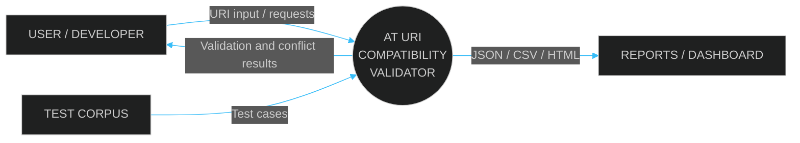

**Explanation:** The user submits an individual URI or runs the test corpus. The validator analyses the input and returns the results through the web interface or generated reports.

## 16.2 Level 1 — Main Processing DFD

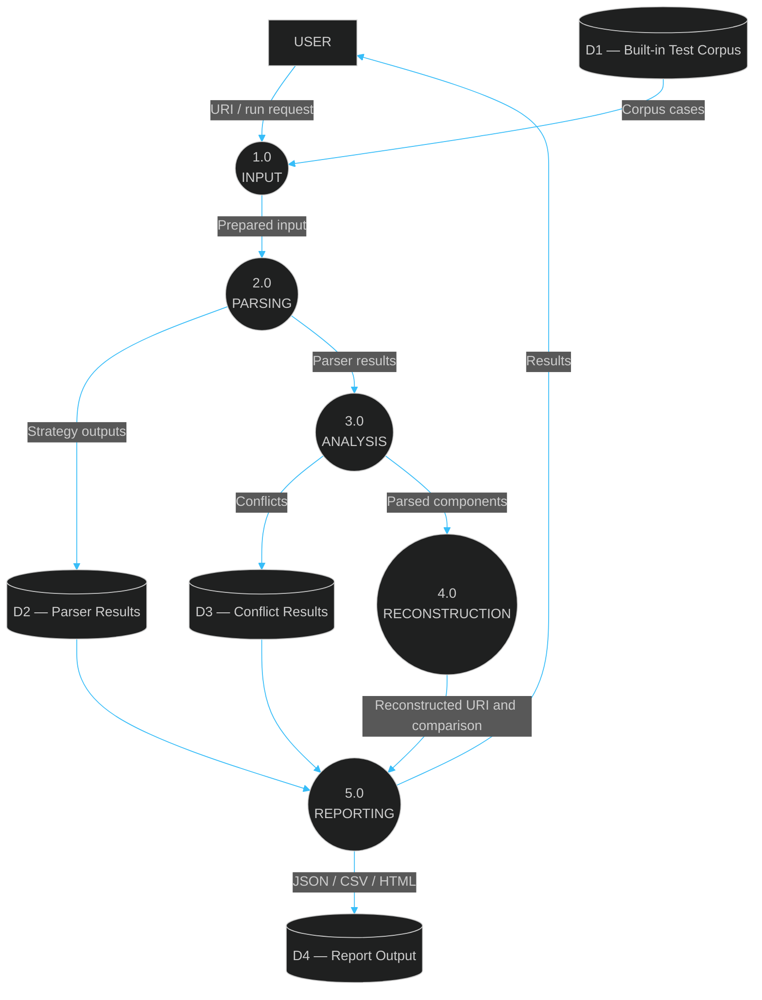

## 16.3 Level 2 — Parsing and Conflict Analysis

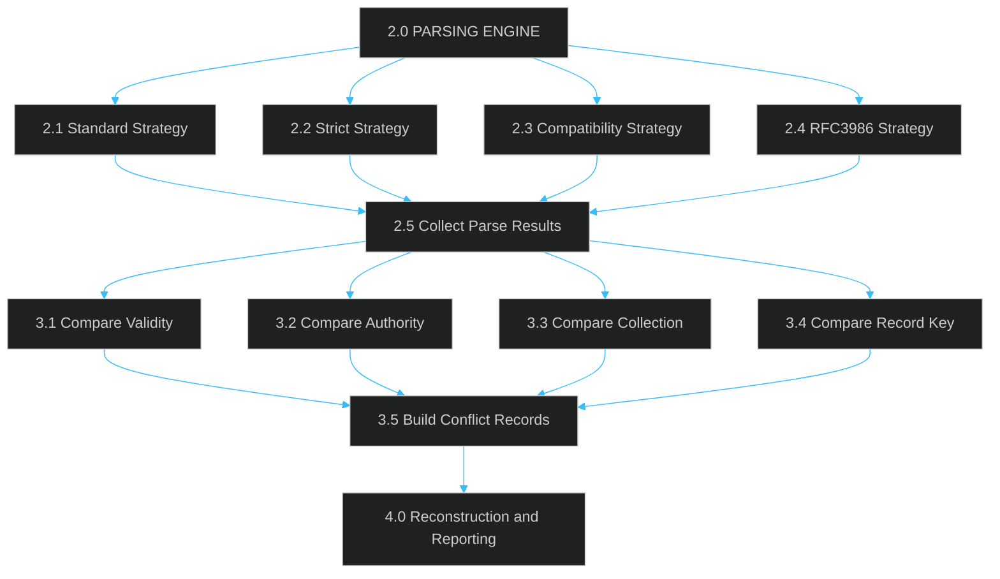

---

<a id="uml-diagrams"></a>
<a id="section-17"></a>
# 17. Uml Diagrams
<p align="left">
  
</p>

## 17.1 Use Case Diagram

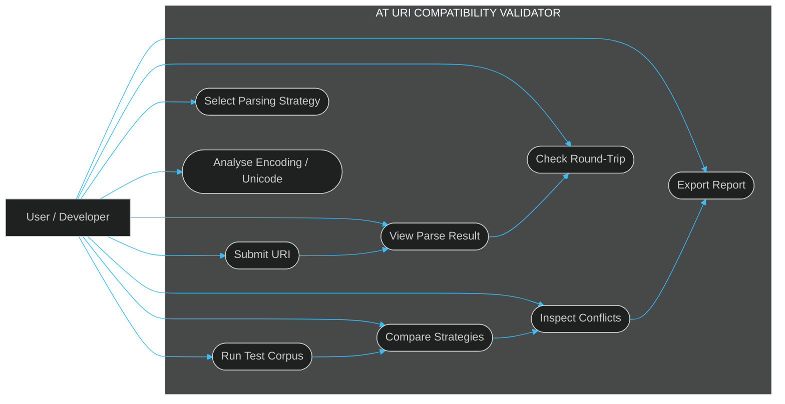

## 17.2 Class Diagram

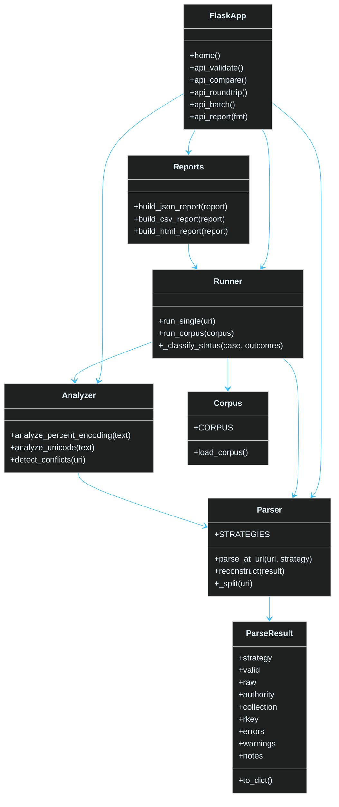

## 17.3 Sequence Diagram

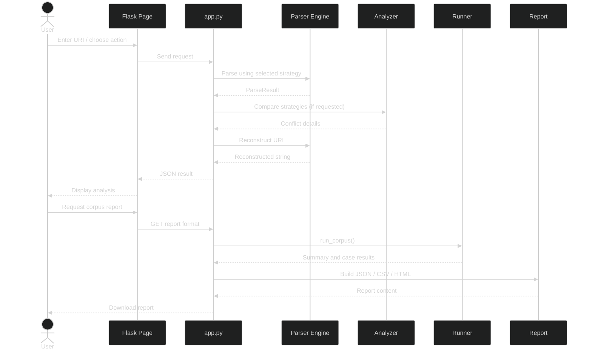

## 17.4 Activity Diagram

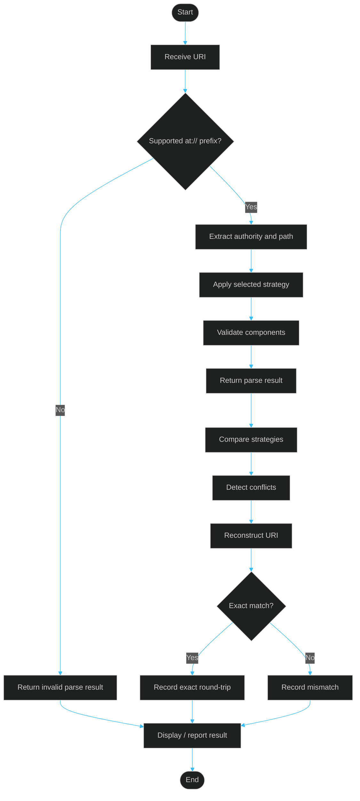

---

<a id="dashboard-and-pages"></a>
<a id="section-18"></a>
# 18. Dashboard And Pages
<p align="left">
  
</p>

The Flask application defines browser routes for the following pages:

| Route | Page purpose |
|---|---|
| `/` | Home page |
| `/dashboard` | Main dashboard |
| `/simulator` | URI simulator with strategy selection |
| `/compare` | Strategy comparison |
| `/batch` | Batch URI analysis |
| `/library` | URI/case library |
| `/conflicts` | Conflict analysis |
| `/roundtrip` | Reconstruction analysis |
| `/encoding` | Percent-encoding and Unicode analysis |
| `/reports` | Report interface |
| `/docs` | Project documentation page |

### Dashboard workflow

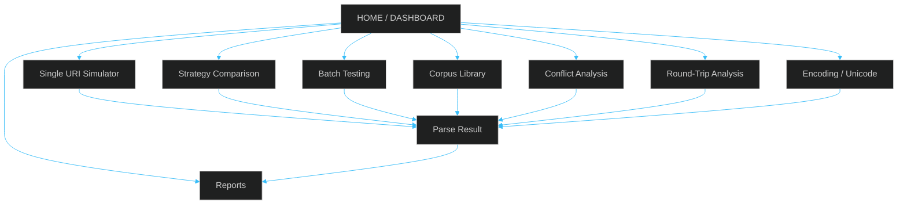

---

<a id="installation-and-execution"></a>
<a id="section-19"></a>
# 19. Installation And Execution
<p align="left">
  
</p>

## 19.1 Prerequisites

| Requirement | Purpose |
|---|---|
| Python 3.10 or later | Runs the application |
| pip | Installs Python packages |
| Git | Clones the repository |
| Web browser | Opens the dashboard |
| Code editor | Optional, for inspecting or modifying code |

## 19.2 Clone the repository

```bash
git clone https://github.com/aiori-hackathon/A3-PS026-TC073.git
cd A3-PS026-TC073
```

## 19.3 Create a virtual environment

```bash
python -m venv .venv
```

### Windows PowerShell

```powershell
.venv\Scripts\Activate.ps1
```

If PowerShell blocks activation, use Command Prompt:

```cmd
.venv\Scripts\activate.bat
```

### Linux / macOS

```bash
source .venv/bin/activate
```

## 19.4 Install dependencies

The current Flask application imports the experimental ML module. That module imports pandas, scikit-learn and joblib. Install these packages as well as the dependencies listed in `requirements.txt`:

```bash
python -m pip install --upgrade pip
pip install -r requirements.txt
pip install pandas scikit-learn joblib
```

## 19.5 Start the application

```bash
python app.py
```

Open this address in your browser:

```text
http://127.0.0.1:5000
```

The Flask server is configured to listen on `127.0.0.1`, port `5000`.

## 19.6 Run automated tests

```bash
pytest tests/ -v
```

## 19.7 Generate and download reports

The report builder is called through the Flask API. It is not a command-line script with `--corpus` and `--out` arguments.

Open these endpoints while the Flask server is running:

```text
http://127.0.0.1:5000/api/run-corpus
http://127.0.0.1:5000/api/report/json
http://127.0.0.1:5000/api/report/csv
http://127.0.0.1:5000/api/report/html
```

The report endpoints return downloadable files.

### Execution flow


---

<a id="api-reference"></a>
<a id="section-20"></a>
# 20. Api Reference
<p align="left">
  
</p>

**Base URL**

```text
http://127.0.0.1:5000
```

The following endpoints are defined in the current `app.py`.

| Method | Endpoint | Purpose |
|---|---|---|
| GET | `/api/health` | Returns application status and supported strategies. |
| POST | `/api/validate` | Parses a URI using the selected strategy. |
| POST | `/api/compare` | Compares strategies and returns conflict details. |
| POST | `/api/roundtrip` | Reconstructs a URI and reports exact-match status. |
| POST | `/api/encoding` | Analyses percent escapes and Unicode. |
| POST | `/api/batch` | Processes multiple URI inputs. |
| GET | `/api/corpus` | Returns the built-in corpus. |
| GET | `/api/run-corpus` | Executes the corpus and returns aggregate results. |
| POST | `/api/ml-predict` | Runs the experimental ML conflict prediction. |
| GET | `/api/report/json` | Downloads the JSON report. |
| GET | `/api/report/csv` | Downloads the CSV report. |
| GET | `/api/report/html` | Downloads the HTML report. |

## 20.1 Validate one URI

**Request**

```bash
curl -X POST http://127.0.0.1:5000/api/validate \
  -H "Content-Type: application/json" \
  -d "{\"uri\":\"at://did:plc:abc123/app.bsky.feed.post/3kxyz\",\"strategy\":\"standard\"}"
```

The endpoint returns a `result` object and a `reconstructed` value.

## 20.2 Compare strategies

```bash
curl -X POST http://127.0.0.1:5000/api/compare \
  -H "Content-Type: application/json" \
  -d "{\"uri\":\"at://did:plc:abc123/app.bsky.feed.post/3kxyz\"}"
```

## 20.3 Check round-trip

```bash
curl -X POST http://127.0.0.1:5000/api/roundtrip \
  -H "Content-Type: application/json" \
  -d "{\"uri\":\"at://did:plc:abc123/app.bsky.feed.post/3kxyz\",\"strategy\":\"standard\"}"
```

The response includes:

- `original`
- `reconstructed`
- `exact_match`
- `parsed`

## 20.4 Analyse encoding

```bash
curl -X POST http://127.0.0.1:5000/api/encoding \
  -H "Content-Type: application/json" \
  -d "{\"text\":\"did%3Aplc%3Aabc123\"}"
```

## 20.5 Batch validation

```bash
curl -X POST http://127.0.0.1:5000/api/batch \
  -H "Content-Type: application/json" \
  -d "{\"uris\":[\"at://alice.bsky.social/app.bsky.feed.post/x\",\"at://did:plc:abc123/app.bsky.feed.post/y\"]}"
```

## 20.6 Health check

```bash
curl http://127.0.0.1:5000/api/health
```

---

<a id="sample-requests"></a>
<a id="section-21"></a>
# 21. Sample Requests
<p align="left">
  
</p>

## Example 1 — Valid handle-based URI

```text
at://alice.bsky.social/app.bsky.feed.post/3kabc
```

Expected components:

```text
Scheme       : at
Authority    : alice.bsky.social
Collection   : app.bsky.feed.post
Record key   : 3kabc
```

## Example 2 — DID-based URI

```text
at://did:plc:abc123/app.bsky.feed.post/3kxyz
```

Important observation:

```text
The complete value did:plc:abc123 is the authority.
Its colons belong to the DID identifier.
```

## Example 3 — Invalid scheme case

```text
AT://did:plc:abc123/app.bsky.feed.post/3kxyz
```

The current parser checks the exact lowercase `at://` prefix. The input therefore does not pass the prefix check.

## Example 4 — Invalid record-key character

```text
at://alice.bsky.social/app.bsky.feed.post/abc!
```

The record-key regular expression does not permit `!`; the parser records a validation issue according to the selected strategy.

---

<a id="testing-and-results"></a>
<a id="section-22"></a>
# 22. Testing And Results
<p align="left">
  
</p>

## 22.1 Testing strategy

| Test type | Purpose |
|---|---|
| Parser tests | Verify URI splitting and component extraction. |
| Authority tests | Check DID and handle handling. |
| Strategy tests | Check behaviour under all four strategies. |
| Encoding tests | Check valid and malformed percent escapes. |
| Unicode tests | Check NFC and NFD normalization behaviour. |
| Reconstruction tests | Check exact URI reconstruction. |
| Corpus tests | Check corpus size, unique IDs and execution. |
| Conflict tests | Check that conflict analysis returns structured results. |

## 22.2 Run the tests

```bash
pytest tests/ -v
```

The repository's `tests/test_engine.py` includes checks for DID authority preservation, handle authority, rejection of non-AT schemes, reconstruction, RFC-style DID/port ambiguity, percent encoding, Unicode, corpus size, unique case IDs and corpus execution.

## 22.3 Report formats

| Format | Purpose |
|---|---|
| JSON | Structured data for programmatic analysis. |
| CSV | Tabular results for spreadsheet analysis. |
| HTML | Browser-readable case report. |

The report includes case IDs, input values, categories, expected labels, status, standard-strategy validity, extracted authority and purpose.

## 22.4 Interpreting corpus status

| Status | Meaning |
|---|---|
| `pass` | Actual standard-strategy validity matches the expected valid/invalid label. |
| `fail` | Actual standard-strategy validity does not match the expected label. |
| `review` | The corpus case is intentionally marked for review. |

The corpus runner computes the status from the annotations and actual execution. Results should be generated from the current code rather than copied as fixed numbers into documentation.

---

<a id="limitations-and-future-scope"></a>
<a id="section-23"></a>
# 23. Limitations And Future Scope
<p align="left">
  
</p>

## 23.1 Current limitations

1. **Parser independence:** The current four strategies are modes of one custom parser implementation, not separate independent third-party parser libraries.
2. **Specification pinning:** Reproducibility requires recording the exact AT URI specification revision and parser/library versions used for comparison.
3. **Corpus coverage:** A finite corpus cannot cover every possible URI or implementation behaviour.
4. **Network resolution:** Syntax validation does not prove that an account or record is available.
5. **Transformation depth:** The final architecture's independent Transform A and Transform B reversible pipelines need further implementation.
6. **Offset alignment:** Character-level interval/offset alignment is part of the target architecture, not a separate current module.
7. **ML experiment:** The ML prediction module creates synthetic training examples. Its confidence output should not be treated as a standards-based validity result or a reliable generalization metric.
8. **Dependency declaration:** The current `app.py` imports the ML module, which imports pandas, scikit-learn and joblib. These packages should be declared in `requirements.txt` or the ML import should be made optional.

## 23.2 Future improvements

| Future enhancement | Expected benefit |
|---|---|
| Independent RFC 3986 parser adapter | A reproducible comparison against a separate parser implementation. |
| WHATWG URL parser adapter | Additional cross-implementation evidence. |
| Specification Oracle | Compare results against a pinned authoritative specification implementation. |
| Interval-tree offset alignment | Locate exact character-level disagreements. |
| Reversible Transform A / B | Test alternate representations and restoration. |
| Time Vault | Compare results across specification and parser versions. |
| Shield | Add policy checks for unsafe or ambiguous parser behaviour. |
| Live resolution | Separately test whether a syntactically valid identifier resolves. |
| CI regression tests | Run the corpus automatically after code changes. |

## 23.3 Future architecture direction

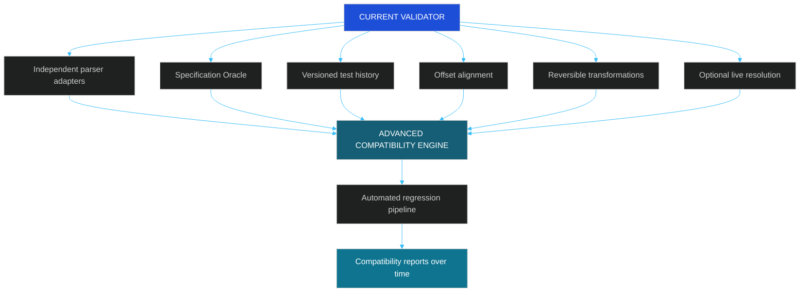

---

<a id="team-and-references"></a>
<a id="section-24"></a>
# 24. Team And References
<p align="left">
  
</p>

## Project team

| Member | Contribution area |
|---|---|
| Tanvi Pawar | Problem understanding and technical research |
| Mushaffa Matwankar | Solution development and testing |
| Mentor: Prof. K. M. Gajmal | Project mentorship |

## Hackathon information

| Detail | Information |
|---|---|
| Event | AIORI Hackathon 3 |
| Track | 6G & Future Networks |
| Problem ID | A3-PS026-TC073 |
| Project | AT URI Syntax Compatibility & Round-Trip Validator |

## Technical references

1. [AT Protocol — AT URI Scheme](https://atproto.com/specs/at-uri-scheme)
2. [RFC 3986 — Uniform Resource Identifier (URI): Generic Syntax](https://www.rfc-editor.org/rfc/rfc3986.html)
3. [WHATWG URL Standard](https://url.spec.whatwg.org/)
4. [W3C — Decentralized Identifiers (DIDs) v1.0](https://www.w3.org/TR/did-core/)
5. [Python — urllib.parse](https://docs.python.org/3/library/urllib.parse.html)
6. [Flask Documentation](https://flask.palletsprojects.com/)
7. [pytest Documentation](https://docs.pytest.org/)

---

<div align="center">


**AT URI Syntax Compatibility & Round-Trip Validator**

AIORI Hackathon 3 · 6G & Future Networks

<a href="https://youtu.be/q6_cSCNCk_s?si=WVBeHfXlIBHVIyU7">Project Video</a> ·
<a href="https://youtu.be/rQl8qc3ovc8?si=hfWA_Vnl4Suaje3C">Demo Walkthrough</a> ·
<a href="https://github.com/aiori-hackathon/A3-PS026-TC073">GitHub Repository</a>

</div>

